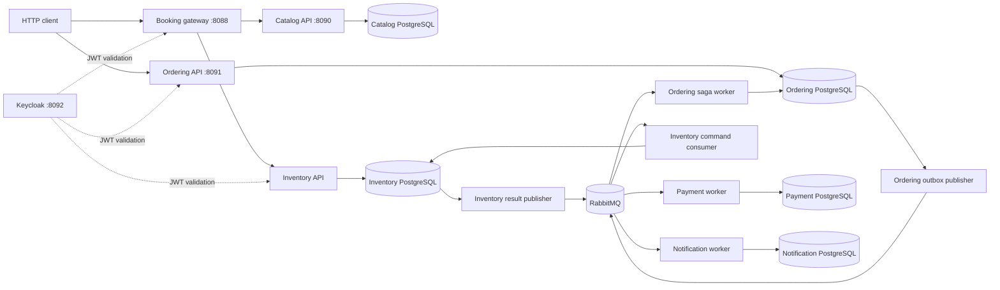

# TicketRush — distributed flash-sale ticket booking (.NET 10)

**Status: Phase 2.3r validated locally; Phase 3 performance work is next.** This repository implements a containerized, event-driven checkout demonstration with independently persisted **Catalog, Inventory, Ordering, Payment, and Notification** components. It is a **development portfolio project, not a production ticketing service**. The latest duplicate-checkout-event replay tests and local recovery scripts were reported passing on 23 October 2026.

**Central invariant:** a seat must never be sold twice. PostgreSQL is authoritative for reservations and sales. RabbitMQ provides asynchronous delivery; PostgreSQL outbox/inbox records and idempotent handlers protect the business workflow against retries and duplicated events.

> **Existing deployment?** If upgrading a database created before the independent Inventory split, **do not use the fresh-install instructions below**. Follow [Phase 2.3o.2c Inventory cutover](README-STEP2.3O2C-APPLY.md), [scripted copy](README-STEP2.3O2C-SCRIPTED-CUTOVER.md), and [snapshot verification](README-STEP2.3O2C-CUTOVER-CHECK.md). Preserve your Docker volumes. After new Inventory writes, switching back to the old Booking DB is unsafe without reconciliation.

## What the project demonstrates

- **Concurrency correctness:** atomic 1–6-seat holds, PostgreSQL row locks, time-limited reservations, idempotent commands, and sale-state constraints.
- **Distributed checkout:** an Ordering-owned intent and transactional outbox, RabbitMQ delivery, a persistent saga worker, simulated Payment authorization, Inventory sale processing, and simulated terminal Notification receipts.
- **Failure recovery:** outbox retry after broker outage, Inventory consumer outage recovery, saga redrive, payment-void compensation, and duplicate-event replay without duplicate business effects.
- **Service ownership:** separately hosted Catalog, Inventory, and Ordering APIs; independent Inventory, Ordering, Payment, Notification, and Catalog PostgreSQL databases. The Booking HTTP API is a transitional gateway, not a database owner in the standard Compose deployment.
- **Authentication:** local Keycloak OIDC/JWT validation and buyer identity checks; Booking issues a signed temporary hold proof required by the Ordering checkout API.
- **Verification:** xUnit integration tests with Testcontainers/PostgreSQL and PowerShell Docker Compose smoke/recovery scripts. Measurements of throughput, allocation, and multi-replica scaling are **not** yet published.

### Architecture (implemented in Phase 2.3r)



Catalog is read-only in this demo. The legacy Booking PostgreSQL database is retained for compatibility/migration, **not** used for new checkout or Inventory writes in the normal deployment. Checkout is a custom durable RabbitMQ-backed workflow, **not** an installed MassTransit saga.

## Prerequisites

- .NET 10 SDK and, for Visual Studio users, Visual Studio 2026; Docker Desktop/Engine with Docker Compose enabled.
- PowerShell for the supplied scripts (developed for a Windows local environment).
- Sufficient resources to start the multiple databases, RabbitMQ, Keycloak, APIs, and background workers.
- The application uses **local-only passwords, HTTP, test users, and simulated Payment**. Do not make these Compose services publicly reachable or use the demo realm outside isolated development.

## Quick start — **fresh, disposable** local environment

Run from the repository root in PowerShell. These instructions assume the Inventory database **does not contain historical data requiring migration**.

```powershell
# Generate a random signing key in the git-ignored .env file.
.\scripts\Initialize-Dev-Hold-Proof.ps1

# Validate Compose configuration, start databases, migration jobs and services.
docker compose config --quiet
docker compose up -d --build

# Seed the separate Inventory database with the same 100-seat demo event
# as Catalog. It is NOT seeded automatically in the normal Compose config,
# because the migrator also supports non-destructive historical-data cutover.
docker compose run --rm -e SEED_DEMO_DATA=true inventory-migrate
```

The last command is for a new/demo Inventory database only. The demo event ID is `11111111-1111-1111-1111-111111111111`, with seats `A-001` through `A-100`. If you have an existing installation, **do not seed or reset your destination**: follow the cutover runbook linked at the top. If Keycloak is still starting, give the realm import time to finish before obtaining a token.

Development endpoints (bound to **127.0.0.1** on the host):

| Endpoint | Service | Purpose |
| --- | --- | --- |
| `http://localhost:8088` | Booking gateway | Public event/seat queries; authenticated holds and signed proofs |
| `http://localhost:8090` | Catalog API | Event list |
| `http://localhost:8091` | Ordering API | Authenticated `/checkouts` commands and status |
| `http://localhost:8092` | Keycloak | Development OIDC realm |
| `http://localhost:15672` | RabbitMQ management | Development diagnostics |

PostgreSQL is locally mapped to ports `5439` (legacy Booking), `5440` (Catalog), `5441` (Ordering), `5442` (Payment), `5443` (Notification), and `5444` (Inventory). These are **separate databases**. The Inventory API and RabbitMQ AMQP port are not exposed directly on host ports by Compose.

### Try one authenticated checkout

For a quick end-to-end demonstration, run the already provided script:

```powershell
.\scripts\Verify-Checkout-Api-Saga.ps1
```

It obtains a development JWT from Keycloak, creates a hold through Booking, submits an asynchronous checkout to Ordering, waits for completion, and verifies downstream database evidence. **It permanently sells one available demo seat.** The `Verify-Notification-Service.ps1` script additionally checks the durable simulated notification receipt.

The HTTP contract is:

1. `GET http://localhost:8088/events` and `GET http://localhost:8088/events/{eventId}/seats` are anonymous reads.
2. Obtain Alice's test token with `.\scripts\Get-Dev-BuyerToken.ps1 -Username alice`. Alice's demo buyer ID is `aaaaaaaa-aaaa-4aaa-8aaa-aaaaaaaaaaaa`.
3. Send an authenticated `POST http://localhost:8088/events/{eventId}/holds` with JSON `{"buyerId":"...","idempotencyKey":"unique-hold-key","seatCodes":["A-001"]}`. The successful response includes a `holdProof` and hold ID.
4. Send authenticated `POST http://localhost:8091/checkouts` with JSON `{"buyerId":"...","holdId":"...","holdProof":"...","idempotencyKey":"unique-checkout-key"}`.
5. A first valid request returns **202 Accepted** (durably queued, **not yet purchased**). Poll the authenticated `GET http://localhost:8091/checkouts/{orderId}?buyerId={buyerId}` until the state is `Completed` or `Failed`. Repeated equivalent checkout commands use idempotency and may return **200 OK**.

**Important:** `POST /orders` and `GET /orders/{id}` on the Booking gateway have been **retired** and return HTTP **410 Gone** for authenticated calls in normal Compose mode. The synchronous checkout remains only in explicit development/test compatibility mode. Do not use older Phase 1 curl examples against the standard distributed deployment.

## Build and tests

```powershell
dotnet restore TicketRush.slnx
dotnet build TicketRush.slnx -c Release
dotnet test TicketRush.slnx -c Release --no-build
```

Tests include real PostgreSQL-backed concurrency, migration, API contract, outbox/inbox, saga, Payment, Inventory and Notification scenarios. Docker must be running for Testcontainers tests. **No fixed test count is stated:** use the output of the current suite as the baseline. A passing suite does not by itself establish production load capacity.

### Smoke and failure-recovery tests

Non-destructive deployment checks:

```powershell
.\scripts\Verify-Inventory-Database-Separation.ps1
.\scripts\Verify-Legacy-Checkout-Retired.ps1
```

Representative end-to-end tests (may create/sell demo seats):

```powershell
.\scripts\Verify-Inventory-Api-Bridge.ps1
.\scripts\Verify-Checkout-Api-Saga.ps1
.\scripts\Verify-Payment-Void-Compensation.ps1
.\scripts\Verify-Notification-Service.ps1
```

Disruptive, **opt-in** tests; run only on an idle disposable local Compose stack:

```powershell
.\scripts\Verify-Inventory-Consumer-Outage-Recovery.ps1 -AllowDisruption
.\scripts\Verify-RabbitMq-Outage-Outbox-Recovery.ps1 -AllowDisruption
.\scripts\Verify-Checkout-Fact-Ambiguous-Ack-Replay.ps1 -AllowDisruption
```

These scripts stop service components or re-arm a test outbox event, then verify recovery and idempotency. Read the respective [Phase 2.3p](README-STEP2.3P-APPLY.md), [2.3q](README-STEP2.3Q-APPLY.md), and [2.3r](README-STEP2.3R-APPLY.md) guides before using them. The Phase 1 `Verify-Phase1-Docker.ps1` targets the **retired synchronous `/orders` path** and is historical, not a normal-deployment verification script.

## Data migration and safety

EF Core migrations run through dedicated `*-migrate` containers. Inventory uses its own `InventoryDbContext`, migrations, and `inventory-postgres` data volume. Existing Booking data is migrated **once** under a maintenance window; the copied records include seats, holds, Inventory sale evidence, and durable inbox/outbox state. The cutover tool does not replace Orders in Ordering's separate database.

- [Cutover/upgrade procedure](README-STEP2.3O2C-APPLY.md)
- [Version-controlled copy script](README-STEP2.3O2C-SCRIPTED-CUTOVER.md): `.\scripts\Invoke-Inventory-DataCutover.ps1 -BackupConfirmed -ConfirmCopy`
- [Pre-restart snapshot verification](README-STEP2.3O2C-CUTOVER-CHECK.md): `.\scripts\Verify-Inventory-Cutover-Copy.ps1`

**Never run `docker compose down -v` on a database you want to preserve.** Retain backups outside Git and never paste signing keys, tokens, database exports, or credentials into pull requests.

## Scope and next development stages

**Implemented and locally reported passing through Phase 2.3r:** transactions, authentication, Catalog/Inventory/Ordering boundaries, simulated Payment and authorization-void compensation, simulated Notification receipts, transactional outbox/inbox, saga retry, and targeted outage/replay tests.

**Not implemented or not demonstrated as of this snapshot:** Redis waiting room/admission control, live seat-map SignalR delivery, Kubernetes/Helm deployment and horizontal-scale measurements, Aspire orchestration, OpenTelemetry-wide tracing/metrics, Native AOT and bitset/GC benchmarks. No real payments, refunds, emails or tickets are issued. The RabbitMQ replay smoke test simulates an ambiguous publisher ACK by republishing the same event; it does not force an actual network-level ACK loss.

**Next: Phase 3.** Establish reproducible load baselines, then investigate concurrent hold contention, Redis admission, and multi-replica throughput with actual measurement evidence. The Phase 3a load-runner patch is **not included in this Phase 2.3r source snapshot**.

## Repository guide

- [Target architecture and limitations](docs/architecture.md) — original design targets, not all implemented features.
- [Roadmap](docs/roadmap/README.md) and [Phase 2 status](docs/phase2-work-plan.md).
- [Entity schema/refactoring](docs/entity-schema-refactor.md), [Catalog extraction](docs/catalog-extraction.md), [Inventory extraction](docs/inventory-extraction.md), and [Ordering extraction](docs/ordering-extraction.md).
- [Architecture decisions](docs/adr/0001-modular-monolith-first.md) and other `docs/adr/` records.
- Root-level `README-STEP*.md` documents are **historical change/application guides**. Their statements such as “pending validation” or “next step” describe the repository *at the time that patch was authored*, not the current state.

The project intentionally exercises the limits of distributed guarantees and records what was verified; it does not claim exactly-once RabbitMQ transport delivery, zero-failure availability, or measured production-scale throughput.
