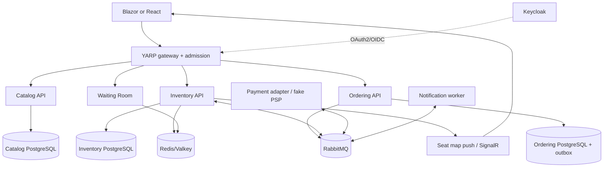

# TicketRush — target architecture

**Follow the original Copilot/Claude Sonnet TicketRush design.** Build correct booking semantics in a modular monolith first, then extract services at proven bounded-context boundaries. This document is a target architecture, not a statement of shipped features.

## Core booking invariant

1. PostgreSQL decides whether seats are available and which order owns them. Redis cannot override a PostgreSQL sale.
2. A multi-seat hold is all-or-nothing. Releasing/expiring an old hold can never change seats that have subsequently been reassigned.
3. Only a non-expired hold owned by the buyer may be confirmed; concurrent checkout is idempotent.
4. `POST /orders` represents an order command. When Payment is added, do **not** mark seats Sold on order receipt: saga state and reservation/payment rules determine the transition.
5. Distributed messages are at-least-once and may arrive out of order; outbox, inbox and idempotent handlers prevent duplicate effects.
6. Fail closed on Redis admission failure rather than bypass limits; allow read-only browsing when feasible. Restore from PostgreSQL on cache restart.

## Later process boundaries

| Service | Why it deserves independent deployment |
|---|---|
| Catalog | Read-heavy queries and venue information; cacheable independently of hot reservation writes |
| Waiting Room | Absorbs flash-sale spikes and admits bounded request rates |
| Inventory | Authoritative seat transitions and hottest contention path; scales/tunes independently |
| Ordering | Owns long-lived checkout saga, order state, transactional outbox |
| Payment | Models failure/latency boundary of an external PSP; idempotent payment commands |
| Notification | Slow, asynchronous email/ticket issuing, isolated from checkout latency |

## Important design correction to initial proposal

Redis `SET NX` / Lua alone is **not** a trustworthy reservation authority: keys may expire, cache data may be evicted/restarted, and a Sold seat may not have an active Redis hold key. For all state-changing requests verify/commit authoritative PostgreSQL inventory and keep cache state synchronized using compensation/reconciliation. Redis may reject obvious contention cheaply, but PostgreSQL rules prevent overselling. This needs an ADR and failure tests.

A claimed `p95 < 50ms`, 50,000 concurrent users, and `200B` allocated per request are **targets**, not measured results; adjust targets based on the actual hardware and benchmark environment. Distinguish the cheap in-memory allocation benchmark from the end-to-end network/database hold request.

## How the existing chat repo fits

Do **not** migrate chat source into TicketRush. Its SSE/Channel/persistence experiences are useful background. A small optional Redis-backed fanout improvement to chat is a separate independent backlog item, not required to complete TicketRush.
